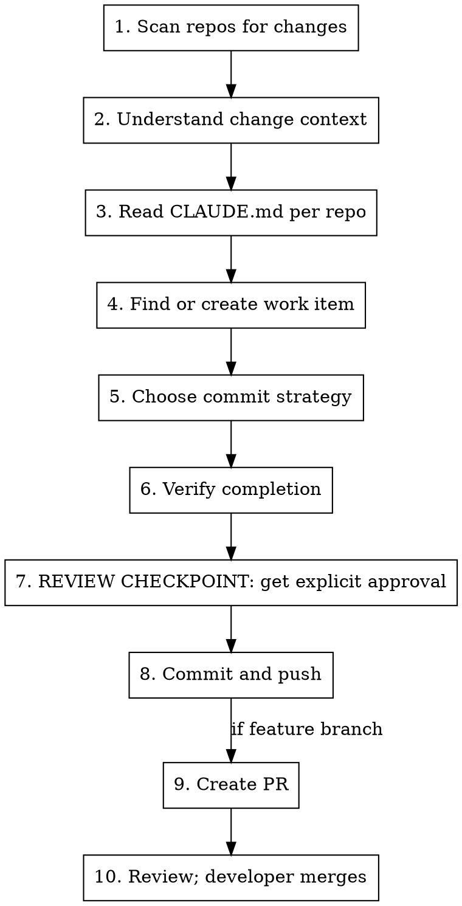

# octo-commit

Structured workflow for committing finished work across OctoMesh repositories with Azure DevOps work item linking, verification, and optional PR creation.

## CRITICAL: Review Checkpoint Before Pushing

**Never push or create a PR without explicit user approval given in the CURRENT session.** This is a firm convention from the repo owner.

- Implementation latitude (permission to write code) does NOT imply push authority.
- Statements like "I'll look at it later", "Ich schau's mir später an", "let me review first" mean **STOP** — do not push, do not open a PR. The user is taking a review checkpoint *before* the push.
- Committing locally may be fine when asked; **pushing and PR creation always require a fresh, explicit go-ahead** ("push it", "create the PR", "ship it").
- When in doubt, ask via **AskUserQuestion** before any `git push` / `gh pr create` / `az repos pr create`.
- **With `octo-claude-pm` installed**, its `agent-operating-rules` decide when an agent may push its own story branch and open the PR without asking (§2.2); everything they do not allow still needs the user's go in the current session.

## With octo-claude-pm installed

When the plugin `octo-claude-pm` is installed, its `agent-operating-rules` §2 are the process rules and this skill does not restate them. Follow them for:

- **Branch** — name, one branch and one PR per repository per Feature slice, docs in the same PR (§2.1).
- **Verification and local review** — the recorded verification and the local review the verify gate checks (§2.2).
- **PR, review rounds and merge** — PR title and body, review rounds, queuing the PR, the developer tests and merges (§2.3).
- **Docs batch** — `octo-documentation` and `octo-claude-skills`: push the story branch **without a PR**; the daily docs batch opens the one PR per repository and sets the plugin version (§2.1). Story branches in these two repositories and in `octo-claude-pm` (which is not batched) leave the plugin version alone and add CHANGELOG lines under `## [Unreleased]` (§2.1).
- **Exceptions to the PR flow** — chain changes and pure CK model / blueprint version bumps directly on `main` happen only as the rules decide (§2.5, §2.5a); this skill never offers a push to `main` as a strategy.
- **Work items** — who creates which item (`backlog-conventions` §2, §12).

The steps below hold with and without the plugin; where they differ, they say so. Without `octo-claude-pm` they describe a generic branch-and-PR flow.

## Commit Message and PR Title Format

```
AB#<WorkItemId> <Type>: <Description>
```

The same format applies to commit messages and PR titles. `<Type>` is exactly one of `Fix`, `New`, `Chore`, `Refactor`, `Test`, `Docs` — CodeRabbit's title check (org-wide config in `meshmakers/coderabbit`) flags any other word (`Change`, `Feat`, `Update`) or a missing type. Automated commits (release manifests, docs-harvest bots, dependabot) and merge commits are exempt. Source: [meshmaker Development Guidelines](https://dev.azure.com/meshmakers/OctoMesh/_wiki/wikis/OctoMesh.wiki/141/Development-Guidelines-for-meshmaker-Teams).

| Type | Use for | Example |
|------|---------|---------|
| `New` | New functionality (User Story, legacy Issue, Task) | `AB#4521 New: Add pipeline validation endpoint` |
| `Fix` | Correction of wrong behaviour (Bug, or a Task that corrects something) | `AB#4493 Fix: Resolve null reference in CK compilation` |
| `Refactor` | Restructuring without behaviour change | `AB#1234 Refactor: Extract the catalog resolver` |
| `Test` | Tests only | `AB#1234 Test: Cover the empty-seed case` |
| `Docs` | Documentation only (READMEs, CLAUDE.md, skills, guides) | `AB#1234 Docs: Describe the title convention` |
| `Chore` | Maintenance: dependency or version bumps, build/CI configuration, tooling | `AB#1234 Chore: Bump the pipeline template pin` |

`New` and `Fix` cover most commits. Choose the type from what the change does; the work item type is only a hint (Bug → usually `Fix`, User Story/Task → usually `New`). Confirm with the user when the change does not fit one type clearly.

**Description:** imperative mood, concise (e.g., "Add validation" not "Added validation").

## Branch Naming

CI in the OctoMesh repos triggers on `dev/*`, `test/*`, and `main` (see each repo's `azure-pipelines.yml`). A `feat/*` branch matches no trigger — pushes build nothing; CI runs once a PR is opened. See also the [meshmaker Development Guidelines](https://dev.azure.com/meshmakers/OctoMesh/_wiki/wikis/OctoMesh.wiki/141/Development-Guidelines-for-meshmaker-Teams).

| Workflow | Pattern | Example | Build on push? |
|----------|---------|---------|----------------|
| Feature branch (default) | `feat/<username>/<short_meaningful_description>` | `feat/reimar/implement-skill` | No — only on PR |
| Long-running feature branch | `dev/AB#<wi-id>_<short_meaningful_description>` | `dev/AB#1234_implement-skill` | Yes — every push |

With `octo-claude-pm` installed, its §2.1 names the branch (`<user>/AB#<id>_<desc>`) and decides when stories share one. Without it, default to the **feat** pattern unless the user explicitly wants a CI build on every push (then use the long-running `dev/...` pattern). Derive `<username>` from `git config user.name` (first name, lowercase). Derive `<short_meaningful_description>` from the work item title or change context (kebab-case, no spaces). The AB# work-item link lives in the commit message and PR title, not in the branch name.

## Workflow



---

### Step 1: Scan All Repos for Pending Changes

Find the monorepo root (directory containing `octo-tools/`) by walking up from the current working directory. Then scan every git repo for uncommitted changes:

```bash
# From the monorepo root
for dir in */; do
  if [ -d "$dir/.git" ]; then
    changes=$(git -C "$dir" status --porcelain 2>/dev/null)
    if [ -n "$changes" ]; then
      echo "=== $dir ==="
      echo "$changes"
    fi
  fi
done
```

Report ALL repos with changes. Do not skip any. Also check for unpushed commits:

```bash
git -C "$dir" log --oneline @{upstream}..HEAD 2>/dev/null
```

### Step 2: Understand Change Context

Gather context from (priority order):

1. **User's prompt** -- explicit description of the work
2. **Conversation history** -- what was discussed/implemented this session
3. **Git diffs** -- `git diff` and `git diff --staged` in each changed repo

If context is unclear, use **AskUserQuestion**:
> "I found changes in [repos]. Can you briefly describe what you worked on?"

### Step 3: Read CLAUDE.md for Each Changed Repo

For every repo with pending changes:

1. Read `<repo>/CLAUDE.md` if it exists
2. Note build commands, test commands, and conventions
3. Note the required build configuration (typically `DebugL` for OctoMesh .NET repos)

**IMPORTANT:** Follow repo-specific conventions from CLAUDE.md. They override defaults.

### Step 4: Find or Create Azure DevOps Work Item

**Azure DevOps context:** Organization `meshmakers`, Project `OctoMesh`.

**Resolution order:**

1. Check if user mentioned a work item ID (AB#1234, "work item 1234")
2. Check current branch name for clues (a `dev/AB#1234_...` branch carries the work-item id; default `feat/...` branches don't — infer from the description)
3. If unknown, analyze the changes and search Azure DevOps with a WIQL query:

```bash
az boards query \
  --wiql "SELECT [System.Id], [System.Title], [System.WorkItemType], [System.State] \
          FROM WorkItems \
          WHERE [System.TeamProject] = 'OctoMesh' \
          AND [System.Title] CONTAINS '<keyword>' \
          AND [System.State] <> 'Closed' \
          ORDER BY [System.ChangedDate] DESC" \
  --org https://dev.azure.com/meshmakers
```

**CRITICAL:** The WIQL command is `az boards query` — there is **no** `az boards work-item query` subcommand (`az boards work-item` only has create/delete/show/update).

**Backlog hierarchy (since 2026-10-09):** Epic → Feature → **User Story** / **Bug** → Task.
Commits reference a requirement-level item — a **User Story**, **Bug** or **Task** — never an Epic or a Feature
(those are planning items for humans). The **Issue** type is legacy: commits may still reference an existing open
Issue, but **never create a new Issue**.

If the search only finds a matching Epic or Feature, do not commit against it: get a User Story under the
matching Feature as described below (or ask which Feature, if only the Epic matches).

Present matching work items to the user with AskUserQuestion if multiple matches found.

**If no matching work item exists:**

- **New functionality needs a User Story.** With `octo-claude-pm` installed, an agent does not create it: it asks the Product Owner agent of the software part for the story (`backlog-conventions` §2, §12) and waits for its ID. Without the plugin, the user creates the story under the right Feature, with acceptance criteria.
- **An agent creates only a Bug or a Task itself.** Ask the user whether to create one, then gather the following via AskUserQuestion:

1. **Type**: Bug (defect) or Task (technical sub-step of a story)
2. **Parent Feature** (required for a Bug): search open Features (WIQL below) and let the user pick.
   Maintenance or quality work without a real Feature goes to the team's current Sustain Feature,
   titled `Sustain Q<n>/<year> – <Team>`. A Task's parent is the User Story it belongs to.
3. **Team / Area**: use the parent Feature's area path (one theme team per Feature)
4. **Iteration**: none for product work — the product theme teams work without sprints (since 2026-10-09);
   leave the iteration at the project root `OctoMesh`. Only customer-project, sales or bizops items may use
   their team's iterations.

```bash
# Open Features to choose a parent from (add a CONTAINS filter on the title to narrow down)
az boards query \
  --wiql "SELECT [System.Id], [System.Title], [System.AreaPath] FROM WorkItems \
          WHERE [System.TeamProject] = 'OctoMesh' AND [System.WorkItemType] = 'Feature' \
          AND [System.State] NOT IN ('Closed', 'Removed') ORDER BY [System.Title]" \
  --org https://dev.azure.com/meshmakers
```

**OctoMesh Azure DevOps teams** (use the exact names):
- Theme teams (product work, no sprints): `Core Platform Team`, `Studio UX Team`, `Platform Ops Team`, `Apps Team`, `Energy Solution Team`, `AI Platform Team`
- Other teams: `Product Team` (portfolio view over all Product Team areas), `Solutions Team` (plural), `CustomerProjects Team`, `Sales Team`, `BizOps Team`

```bash
# List available iterations for a team (non-product teams only)
az boards iteration team list \
  --team "Solutions Team" \
  --org https://dev.azure.com/meshmakers \
  --project OctoMesh

# List available areas for a team
az boards area team list \
  --team "Solutions Team" \
  --org https://dev.azure.com/meshmakers \
  --project OctoMesh
```

Create the Bug and link it to its parent (Mutating — confirm with user first):

```bash
az boards work-item create \
  --type "Bug" \
  --title "<What is wrong, e.g. Tenant list shows deleted tenants>" \
  --area "<AreaPath of the parent Feature>" \
  --iteration "OctoMesh" \
  --fields "Microsoft.VSTS.TCM.ReproSteps=<steps, expected, actual>" \
  --org https://dev.azure.com/meshmakers \
  --project OctoMesh

az boards work-item relation add \
  --id <NewWorkItemId> \
  --relation-type parent \
  --target-id <ParentFeatureId> \
  --org https://dev.azure.com/meshmakers
```

- **Bug:** put the description into `Microsoft.VSTS.TCM.ReproSteps` (via `--fields`), not `--description` — `System.Description` is not the visible field on Bugs.
- **Task:** `--type "Task"` with `--description`; its parent (`--target-id`) is the User Story.

### Step 5: Create the Branch

Every change goes through a branch and a PR; this skill offers no direct push to `main` (the exceptions are decided by `octo-claude-pm` §2.5/§2.5a, not here). Branch from a freshly fetched `main`, named as in Branch Naming above:

```bash
git -C <repo> fetch origin
git -C <repo> log --oneline origin/main..HEAD    # commits of the starting branch that are not on main
```

If that list is empty, branch from `origin/main` (uncommitted changes come along):

```bash
git -C <repo> checkout --no-track -b "<branch>" origin/main
```

If it lists commits that belong to this work (Step 1 reported them as unpushed), branch from the current `HEAD` instead and move them onto `origin/main`, so they are part of the PR:

```bash
git -C <repo> checkout --no-track -b "<branch>" HEAD
git -C <repo> rebase origin/main
```

Commits in that list that do not belong to this work stay on the starting branch: branch from `origin/main` and `git cherry-pick` only the ones that do.

### Step 6: Verify Completion

Before committing, verify the work is ready with **the repository's own build, test and lint commands** — read them from its `AGENTS.md` or `CLAUDE.md` (Step 3). With `octo-claude-pm` installed, run them through its recorded verification for the commit you push (§2.2); the verify gate checks that record.

Only when the repository names no commands, fall back to:

```bash
dotnet build <solution>.sln --configuration DebugL   # .NET
dotnet test <solution>.sln --configuration DebugL
npm run lint && npm test -- --watch=false            # Angular/frontend
```

If build or tests fail, use **AskUserQuestion**:
> "Build/tests failed in [repo]: [error summary]. Fix first, or proceed anyway?"

For significant changes, ask about documentation:
> "Does this change need documentation updates?"

### Step 7: Review Checkpoint — Get Explicit Approval

Before any `git push` / `gh pr create` / `az repos pr create`, you must have explicit approval **in the current session**. Show the user what will happen via **AskUserQuestion**:

> Ready to commit and push:
> - **Repo:** [repo-name]
> - **Message:** `AB#1234 New: Add pipeline validation`
> - **Files:** [file list or summary]
> - **Branch:** feat/reimar/feature-name (or the `octo-claude-pm` branch name)
> - **Will push + open PR:** yes/no

If the user defers ("I'll look at it later"), STOP — you may commit locally only if explicitly asked, but do **not** push or open a PR.

With `octo-claude-pm` installed, the push of your own story branch and the PR follow its §2.2 instead (see the review checkpoint above).

### Step 8: Commit and Push

Build the commit message using the format `AB#<id> <Type>: <Description>` (type from the table in "Commit Message and PR Title Format").

**Co-Authored-By convention:** OctoMesh repos use a **model-specific** trailer of the form
`Co-Authored-By: Claude <model name> <noreply@anthropic.com>` — not a bare `Claude`. Use the
running model's name, e.g. `Co-Authored-By: Claude Opus 4.8 (1M context) <noreply@anthropic.com>`.

For each repo with changes:

```bash
# Stage changes (prefer specific files over -A when possible)
git -C <repo> add <specific-files>

# Commit with heredoc for proper formatting
git -C <repo> commit -m "$(cat <<'EOF'
AB#<id> <Type>: <Description>

Co-Authored-By: Claude Opus 4.8 (1M context) <noreply@anthropic.com>
EOF
)"

# First push of a new branch MUST set upstream with -u
git -C <repo> push -u origin <branch>

# Subsequent pushes (upstream already set)
git -C <repo> push
```

**CRITICAL:** The initial push of a freshly created feature branch requires `-u`
(`git push -u origin <branch>`) to set the upstream tracking ref; later pushes can use a bare `git push`.

**NEVER force-push to main.** Always confirm before pushing (see Review Checkpoint).

**Branch behind `main`?** Update it from `origin/main`, not with `git pull`:

```bash
git -C <repo> fetch origin
git -C <repo> rebase origin/main
git -C <repo> push --force-with-lease origin "<branch>"   # only your own branch, only right after the rebase
```

A force push is allowed only as `--force-with-lease` on your own branch right after such a rebase (`octo-claude-pm` §2.9); any other force push needs the user's go. In `octo-documentation` and `octo-claude-skills` the push of the story branch ends this skill when `octo-claude-pm` is installed: no PR, the docs batch opens it (§2.1).

### Step 9: Create PR (if feature branch)

**With `octo-claude-pm` 0.46.0 or later installed**, its verify gate refuses PR creation, `gh pr ready`, pushes to a branch with an open non-draft PR and review requests until the commit has the recorded verification and local review of its `agent-operating-rules` §2.2; a refusal prints the command to run. Who reviews locally, the order of the steps and the review rounds are in §2.2 and §2.3 — follow them there.

**For GitHub repos** (majority of OctoMesh repos). Derive the `owner/repo` slug from the origin URL (mostly `meshmakers/<repo>`; some are under `reikla/`, see Repo Remotes). The `sed` keeps the last two path parts, so HTTPS URLs, `git@github.com:` and SSH host aliases such as `git@github-company:` all work:

```bash
repo_slug="$(git -C <repo> remote get-url origin | sed -E 's#\.git$##; s#.*[:/]([^/:]+/[^/]+)$#\1#')"

gh pr create \
  --repo "$repo_slug" \
  --head "$(git -C <repo> branch --show-current)" \
  --title "AB#<id> <Type>: <Description>" \
  --body "$(cat <<'EOF'
## Summary
- <bullet points of changes>

## Azure DevOps Work Item
AB#<id>

## Test Plan
- [ ] Build passes (DebugL)
- [ ] Unit + integration tests pass
- [ ] Manual verification done

Generated with [Claude Code](https://claude.ai/code)
EOF
)"
```

**For Azure DevOps repos** (e.g., `meshmakers_staging`). Use `--work-items` to link the PR
directly to the ADO work item (space-separated IDs):

```bash
az repos pr create \
  --repository <repo-name> \
  --source-branch <branch> \
  --target-branch main \
  --title "AB#<id> <Type>: <Description>" \
  --work-items <id> \
  --org https://dev.azure.com/meshmakers \
  --project OctoMesh
```

Report the PR URL(s) to the user when done.

**After the PR is open: review and merge.** If the plugin `octo-claude-pm` is installed, its `agent-operating-rules` §2.3 apply and this skill does not restate them: the CodeRabbit review rounds, which findings to collect and how to answer them, when a PR is ready, queuing it with `request_merge`, asking the developer to test it, and naming a larger change in the merge request and the test request (there is no human code review; agents never add human reviewers). The developer merges, never the agent.

Without `octo-claude-pm` (GitHub repos; `$repo_slug` as for `gh pr create`):

- CodeRabbit (`coderabbitai[bot]`) reviews every non-draft PR automatically; if no review starts, comment `@coderabbitai review`.
- If the *Title check* in the pre-merge checks of CodeRabbit's PR comment failed, correct the title with `gh pr edit <n> --repo "$repo_slug" --title "AB#<id> <Type>: …"` — the `CodeRabbit` status can stay green while the title check fails.
- Check every finding against the code and the work item instead of applying it blindly; fix the valid ones, decline the rest with a reason, and answer each thread.
- For a change across repositories, the upstream PRs are merged and their packages published first: a green local DebugL build does not show that the downstream PR builds from the remote feeds. In the hand-over, report the merge order and every upstream package that is not yet published.
- Report the PR as ready only once CodeRabbit's review of the current head commit is complete (no pending `CodeRabbit` check, `gh pr checks <n> --repo "$repo_slug"`), the title check passed and every finding is answered.
- **Do not merge the PR yourself** (no `gh pr merge`, no `--admin`, no `--auto`, no approving): leave testing and merging to the developer or a maintainer of the repository.

---

## Multi-Repo Commits

When changes span multiple repos:

1. Use the **same work item ID** and **same commit message prefix** across all repos
2. Commit repos in dependency order (consult CLAUDE.md for build order)
3. Push all repos before creating PRs
4. Cross-reference PRs in their descriptions when related

## Repo Remotes Quick Reference

Most `octo-*` repos live at `meshmakers/<repo>` on GitHub (`gh pr create`). `meshmakers_staging`
is the sole Azure DevOps-hosted repo (`az repos pr create`). `pipeline-editor`, `docs`,
`zenon-dynprop-api`, and `aspire-management-prototype` are under `reikla/` on GitHub.

**CRITICAL:** The local directory `docs` maps to the GitHub repo `reikla/ai-docs` (NOT `reikla/docs`).
If unsure of a repo's remote, verify before pushing: `git -C <repo> remote get-url origin`.

See `${CLAUDE_PLUGIN_ROOT}/skills/octo-commit/references/repo-remotes.md` for the full directory-to-remote table.

## Common Mistakes

| Mistake | Prevention |
|---------|------------|
| Pushing without approval | Get explicit go-ahead **this session** before any push/PR |
| Committing without work item | Always resolve AB# first -- search, or get one (Step 4) |
| Wrong WIQL command | Use `az boards query --wiql`, NOT `az boards work-item query` |
| Wrong or missing type (`Change`, `Feat`, `AB#123: …`) | Exactly one of `Fix`, `New`, `Chore`, `Refactor`, `Test`, `Docs` — CodeRabbit's title check flags anything else |
| Applying CodeRabbit findings blindly | Check each against the code and the work item; fix the valid ones, decline the rest with a reason |
| Merging the PR yourself (`gh pr merge`, `--admin`, `--auto`) | Never; the developer tests and merges — with `octo-claude-pm` installed, follow its `agent-operating-rules` §2.3 |
| Trusting the green `CodeRabbit` status | Read the pre-merge checks in CodeRabbit's PR comment; a failed title check can leave the status green |
| Creating a new Issue | Issue is legacy — use a User Story, Bug or Task under a Feature |
| Agent creating a User Story | With `octo-claude-pm`, ask the PO agent of the software part; agents create only Bugs and Tasks |
| Committing against an Epic or Feature | Reference a User Story / Bug / Task under the Feature (Step 4) |
| Story or Bug without parent | Every new User Story / Bug needs a parent Feature (Sustain Feature for maintenance) |
| Wrong team name | It's `Solutions Team` (plural), not "Solution Team" |
| Bare Co-Authored-By | Use model-specific name: `Claude <model> <noreply@anthropic.com>` |
| Wrong docs remote | `docs` dir -> `reikla/ai-docs`, not `reikla/docs` |
| Missing upstream on new branch | First push needs `git push -u origin <branch>` |
| Not reading CLAUDE.md | Always read before build/test/commit |
| Committing secrets | Review staged files for .env, credentials, tokens |
| Force-pushing to main | Never. Use feature branches for risky changes |
| Wrong build config | OctoMesh .NET repos require `DebugL`, not `Debug` or `Release` |
| Stale branch | Branch from a freshly fetched `origin/main`; update with `git rebase origin/main`, then `--force-with-lease` on your own branch only |
| Verifying with a plain `dotnet build` | Run the repository's own build, test and lint (AGENTS.md / CLAUDE.md), recorded with `octo-claude-pm` |
| Opening a PR in `octo-documentation` / `octo-claude-skills` | With `octo-claude-pm`, push the story branch only; the daily docs batch opens the PR |

## Red Flags -- STOP and Verify

- **About to push or open a PR without explicit approval in the current session** — STOP. "I'll look at it later" means do not push.
- About to commit without an AB# work item link
- About to push to `main` (only the `octo-claude-pm` exceptions §2.5/§2.5a allow it)
- Tests not run or failing
- Changes in repos you haven't read CLAUDE.md for
- Sensitive files in the staging area (.env, appsettings with secrets)
- Pushing a new branch without `-u` (upstream not set)
